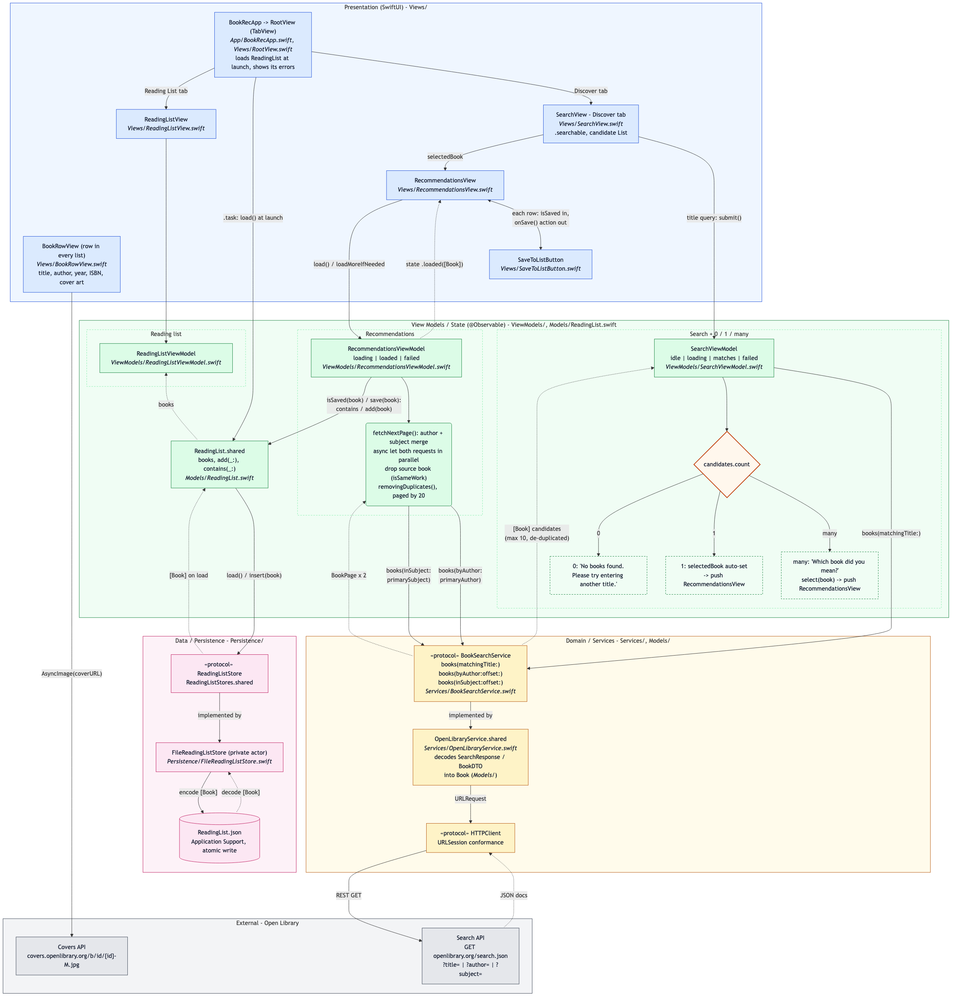
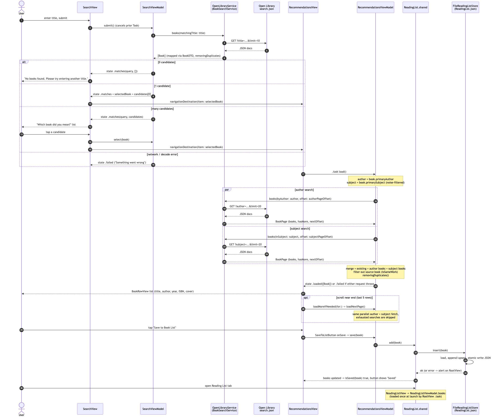

# BookRec

An iOS app that recommends books based on a title you enjoyed and lets you keep a local reading list. Built with SwiftUI, async/await and the [Open Library Search API](https://openlibrary.org/dev/docs/api/search).

- **Platform:** iOS 17+, Swift 5 language mode, no third-party dependencies
- **Architecture:** MVVM with protocol-backed services for dependency injection (easily unit tested)
- **Persistence:** a JSON file on disk (production would be CoreData or SwiftData)
- **Networking:** a dedicated REST service layer (`HTTPClient` + `OpenLibraryService`)

## Getting started

Open `BookRec.xcodeproj` in Xcode 26 or later, then run the `BookRec` scheme on a simulator (⌘R) or run the tests with ⌘U.
Set your own signing team in the target's Signing & Capabilities settings.

## How the requirements map to the code

| Requirement                                   | Where                                                                                                          |
| --------------------------------------------- | -------------------------------------------------------------------------------------------------------------- |
| Enter a title, get recommendations            | `SearchViewModel.search(title:)` → pushed `RecommendationsView` → `RecommendationsViewModel.load()`    |
| No match → prompt to retry                   | `State.notFound` → "No books found… try another title"                                                     |
| Ambiguous match → choose the right book      | `State.matches` → candidate list; each row pushes that book's recommendations, and Back returns to the list |
| Single match → straight to recommendations   | `search(title:)` sets `selectedBook = match` when the search returns exactly one book                      |
| Recommendation = author query + subject query | `RecommendationsViewModel` (both requests run concurrently)                                                  |
| Display title, author, year, ISBN, cover art  | `BookRowView`                                                                                                |
| "Save to Book List" persists locally          | `SaveToListButton` → `ReadingListViewModel.add` → `FileReadingListStore.insert`                        |
| Review the Reading List                       | `ReadingListView` (second tab; swipe or Edit to remove)                                                      |

## Project layout

```
BookRec/
  App/                 App entry point
  Models/              Book (app model) and OpenLibraryDTO (wire format + mapping)
  Services/            BookSearchService protocol (REST service layer), OpenLibraryService, HTTPClient
  Persistence/         ReadingListStore protocol + FileReadingListStore (JSON file)
  ViewModels/          SearchViewModel, RecommendationsViewModel, ReadingListViewModel
  Views/               SwiftUI views
BookRecTests/          Unit tests with stubbed network / temporary-file storage
```

## Architecture diagrams





## Design decisions

- **One state value per screen, navigation for the drill-down.** `SearchViewModel.State` (`idle`, `loading`, `notFound`, `matches`, `failed`) drives the Discover root, and `RecommendationsViewModel.State` (`loading`, `loaded`, `failed`) drives each pushed recommendations screen. Impossible combinations (results and an error at once, a stale spinner) can't be represented, and each view is a plain switch over its state. Choosing a candidate pushes onto a `NavigationStack` via `navigationDestination(item:)` bound to `SearchViewModel.selectedBook`, so the user can go back and pick a different candidate without searching again. Each pushed screen owns its request, so a failed recommendation load never disturbs the candidate list.
- **DTO separated from the domain model.** The API schema is explicitly "not guaranteed to be stable", so every field in `BookDTO` is optional; records without a key or title are dropped instead of failing the whole response.
- **Recommendation algorithm.**
  1. Author query using the matched book's first author.
  2. Subject query using the matched book's first *useful* subject (Open Library subject lists include catalogue noise such as "Accessible book" or `nyt:…` tags, which are skipped).
  3. Author results come first, then subject results. The matched book and duplicates (by id and by normalized title + author) are removed, across every page loaded so far.
  4. Each `RecommendationsViewModel` holds its screen's paging state: both sources page together with one `offset` and `limit`. A source is skipped once its results run out (a short page, or `numFound` reached), and paging stops when both have run out.
  5. A page only counts if every source still being paged succeeds. Otherwise the offset doesn't advance, the list keeps what it has, and the next scroll near the end requests that page again from both sources.
- **ISBN.** A work lists the ISBNs of every edition; we show an ISBN-13 when one exists, otherwise the first ISBN.
- **Covers.** Loaded from the Covers API by `cover_i` (not rate limited, unlike ISBN lookups) with `?default=false`, so books without a cover get a placeholder rather than a blank image.
- **Persistence.** A JSON file in Application Support (`FileReadingListStore`), accessed through the `ReadingListStore` protocol so the view model stays storage-agnostic. The list is small, so the store is an actor that reads the file, applies one change (`insert` / `delete(id:)`) and writes it back atomically; no write can remove books it wasn't asked about. `ReadingListViewModel` loads the list once at launch (`load()`), then keeps it current itself: it updates `books` only after a store write succeeds, so the UI never shows a state that failed to persist.
- **Query encoding.** Values are percent-encoded manually because `URLComponents` leaves `+` unescaped, which Open Library would read as a space.
- **Cancellation.** A new search cancels any in-flight one and pops back to the root; leaving a recommendations screen cancels its request. Cancelled requests never overwrite newer state.
- **Accessibility.** Book details are combined into a single VoiceOver element; decorative cover art is hidden from accessibility.

## Tests (generated by Claude)

`BookRecTests` covers:

- `OpenLibraryServiceTests` – request construction/encoding, offset/limit, `hasMore` from `numFound` and page length, decoding and mapping, sparse records, HTTP and decoding errors
- `SearchViewModelTests` – not found, single match auto-navigation, disambiguation, new search pops to root, errors
- `RecommendationsViewModelTests` – loading for the chosen book, author-then-subject order, subject selection, empty results, failure and retry, no refetch on revisit, sources paging together, failed page retrying both sources
- `ReadingListTests` – file store round trip/update/replace/persistence across instances, view model add/remove, duplicates, save-failure rollback
- `BookTests` – cover URLs, fallbacks, identity/de-duplication

## Assumptions and possible next steps

- The title search returns the 10 most relevant matches (refine the title to find others). Recommendations are paginated (20 per page, per source): the next page loads when a row within 5 of the end appears.
- Update persistence from plain file storage to CoreData or SwiftData
- Possible additions: offline cache for covers, "mark as read", sorting the reading list, favorite, remove from list.
